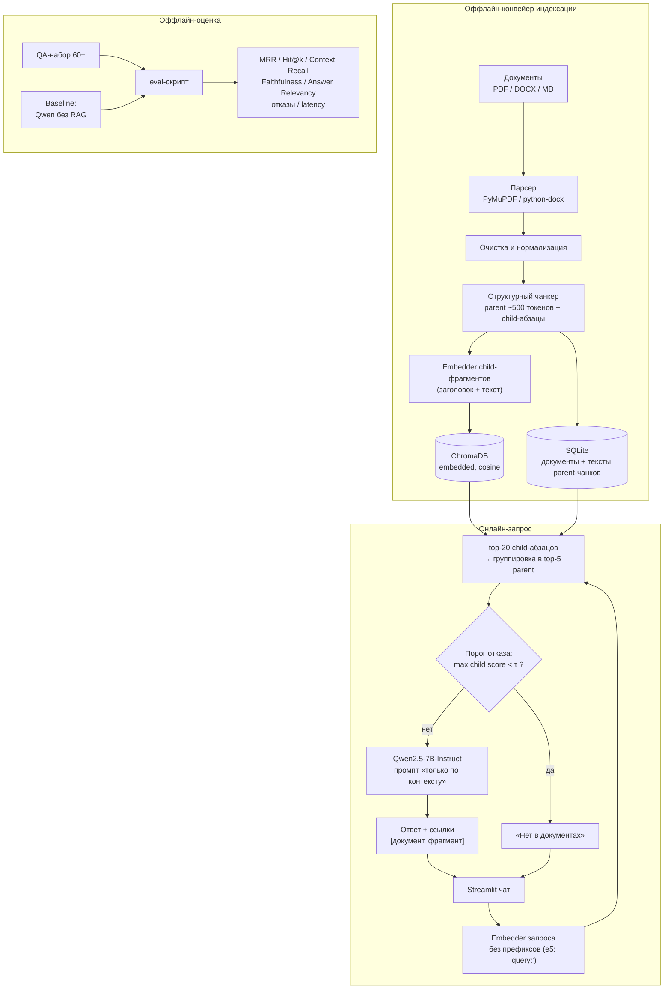

# Архитектура решения

## Общая схема



## Три потока данных

### 1. Индексация (оффлайн, по событию загрузки/переиндексации)

```
файл → парсинг в текст → очистка → структурный чанкинг
     → parent-чанки (~500 токенов) → тексты в SQLite
     → child-абзацы (заголовок+текст) → эмбеддинг → ChromaDB
```

- Запускается из админки (загрузка файла) или CLI (`python -m src.ingest`).
- **Идемпотентность**: ключ parent-чанка = `doc_id:chunk_index`, child'а =
  `doc_id:chunk_index:child_index`; повторная загрузка того же файла (по хэшу
  sha256) отклоняется, переиндексация удаляет старые записи Chroma и SQLite
  по `doc_id` и записывает новые.
- Состояние документа в реестре: `pending → indexing → ready | error` (+ текст ошибки).

### 2. Запрос (онлайн, синхронный)

```
вопрос → эмбеддинг → exact-поиск top-20 child-абзацов в Chroma
       → группировка по parent-чанку (score родителя = лучший child)
       → если max score < τ → отказ «Нет в документах»
       → иначе → top-5 parent-текстов из SQLite → промпт → Qwen
       → ответ + ссылки → Streamlit
```

- Поиск **плоский (exact)**: при 500–5000 child-фрагментов × 1024-dim скан по матрице занимает
  единицы миллисекунд — индексы (HNSW/IVFFlat) не нужны. Это зафиксировано явно, чтобы
  не тратить время на настройку приближённого поиска.
- Порог `τ` и `top_k` — настраиваемы в админке и хранятся в конфиге/сессии (см. [pipeline.md](pipeline.md)).

### 3. Оценка (оффлайн, воспроизводимый скрипт)

```
QA-набор → retrieval-метрики (MRR, Hit@k, Context Recall)
         → generation-метрики (LLM-as-judge: Faithfulness, Answer Relevancy)
         → метрики отказов (correct / false refusal) → latency p50/p95
         → таблица: RAG vs baseline (Qwen без RAG)
```

Подробности — в [evaluation.md](evaluation.md).

## Компоненты

| Компонент | Файл (целевая структура) | Ответственность |
|---|---|---|
| Парсер | `src/ingest/parser.py` | PDF/DOCX/MD → чистый текст + метаданные (заголовки, номера страниц) |
| Чанкер | `src/ingest/chunker.py` | parent-блоки ~500 токенов + child-абзацы для поиска |
| Индексатор | `src/ingest/indexer.py` | эмбеддинг child'ов, запись в Chroma/SQLite, идемпотентная переиндексация |
| Ретривер | `src/retrieve/search.py` | эмбеддинг запроса, top-k child'ов, группировка в parent-чанки, фильтры |
| Порог отказа | `src/retrieve/gate.py` | решение «ответить / отказать» по max score (+ разрыв top1–top2) |
| Генератор | `src/generate/answer.py` | сборка промпта, вызов LLM, разбор ответа, извлечение ссылок |
| LLM-клиент | `src/llm/client.py` | Ollama / OpenAI-совместимый API, единый интерфейс, таймауты, ретраи |
| Метрики | `src/eval/metrics.py` | MRR, Hit@k, Faithfulness, refusal-метрики, latency |
| UI чата | `app.py` + `src/ui/chat.py` | потоковый чат, история, источники |
| UI админки | `src/ui/admin.py` | загрузка, реестр, топ-к/порог, переиндексация, вкладка метрик |

## Модель данных

Хранилища двухуровневые (small-to-big): в Chroma — **child-фрагменты** (абзацы,
это они эмбеддятся и ищутся), в SQLite — **parent-чанки** (~500 токенов, тексты
для контекста LLM).

**ChromaDB** — коллекция `chunks` (строки = child-фрагменты):

| Поле | Тип | Назначение |
|---|---|---|
| `id` | str | `"{doc_id}:{chunk_index}:{child_index}"` |
| `document` | str | текст child-абзаца (без заголовка) |
| `embedding` | float[1024] | нормированный вектор (эмбеддинг «заголовок + текст»), `cosine` |
| `metadata.chunk_id` | str | **ключ parent-чанка** `"{doc_id}:{chunk_index}"` — группировка при поиске |
| `metadata.doc_id` | str | FK на документ |
| `metadata.doc_name` | str | отображаемое имя (для ссылок) |
| `metadata.child_index` | int | порядок child'а внутри parent'а |
| `metadata.heading` | str | ближайший заголовок / пункт (для навигации и эмбеддинга) |
| `metadata.page` | int\|null | номер страницы (PDF, если доступен) |
| `metadata.source_type` | str | pdf / docx / md |

**SQLite** (`data/registry.db`):

Таблица `documents`:

| Поле | Тип | Назначение |
|---|---|---|
| `id` | str (uuid) | идентификатор |
| `name` | str | имя файла |
| `sha256` | str | дедупликация, ключ идемпотентности |
| `status` | str | pending / indexing / ready / error |
| `chunks_count` | int | число parent-чанков |
| `error` | str\|null | текст ошибки парсинга |
| `uploaded_at` | datetime | время загрузки |

Таблица `chunks` (parent-чанки):

| Поле | Тип | Назначение |
|---|---|---|
| `id` | str | `"{doc_id}:{chunk_index}"` — тот же ключ, что `metadata.chunk_id` в Chroma |
| `doc_id` | str | FK на документ (каскадное удаление) |
| `chunk_index` | int | порядок чанка в документе |
| `heading` | str | заголовок раздела |
| `page` | int | номер страницы (PDF) |
| `text` | str | полный текст ~500 токенов (с перекрытием) — уходит в контекст LLM |

Тексты ответов и история чатов в БД **не сохраняются** (только `st.session_state`) —
принцип минимизации данных для внутренних документов.

## Конфигурация

Единый источник — `config.yaml` + переменные окружения `.env`:

```yaml
# config.yaml
models:
  embedding_backend: ollama                   # ollama | sentence_transformers
  embedding: qwen3-embedding:0.6b             # ST: intfloat/multilingual-e5-base
  llm: qwen2.5:7b                             # Ollama tag
  llm_endpoint: ${OLLAMA_BASE_URL}            # http://localhost:11434
retrieval:
  top_k: 5                                    # 3..10, правится в админке
  threshold: 0.50                             # откалиброван на dev (см. pipeline.md §5)
  delta: 0.05                                 # мин. разрыв top1-top2 (осторожный ответ)
chunking:
  size_tokens: 500
  overlap_tokens: 50
  min_tokens: 50
generation:
  temperature: 0.2
  max_tokens: 700
  timeout_s: 600                              # CPU-only: 7B медленная
```

```bash
# .env
OLLAMA_BASE_URL=http://localhost:11434
# OPENAI_API_KEY=...          # опциональный API-fallback для LLM/judge
# RAG_EMBED_DEVICE=cpu        # cpu | cuda
```

`top_k` и `threshold`, изменённые в админке, перекрывают значения `config.yaml` в текущей
сессии; кнопка «Сохранить в конфиг» фиксирует их постоянно.

## Почему PostgreSQL + pgvector заменён на ChromaDB

1. **Масштаб не требует сервера БД**: 500–5000 чанков × 768-dim ≈ несколько МБ.
   pgvector даёт отдельный сервер, миграции, дискер-оркестрацию — ради линейного скана,
   который и так мгновенный.
2. **ChromaDB встраивается в приложение**: zero-серверов, персистентность на диске,
   готовая метрика `cosine`, фильтры по метаданным (поиск по конкретным документам),
   API совпадает с привычным «collection + add + query».
3. **Упрощает запуск и демо**: `streamlit run app.py` без поднятия Postgres — меньше
   точек отказа на защите.
4. **Реестр документов** (статусы, хэши) ложится на SQLite из стандартной библиотеки —
   без ORM и миграций.

Если позже понадобится серверный вариант (мультипользовательский доступ, тысячи
документов) — миграция на pgvector тривиальна: те же поля `chunks(doc_id, text, embedding)`,
код ретривера меняется лишь в слое доступа к хранилищу.
