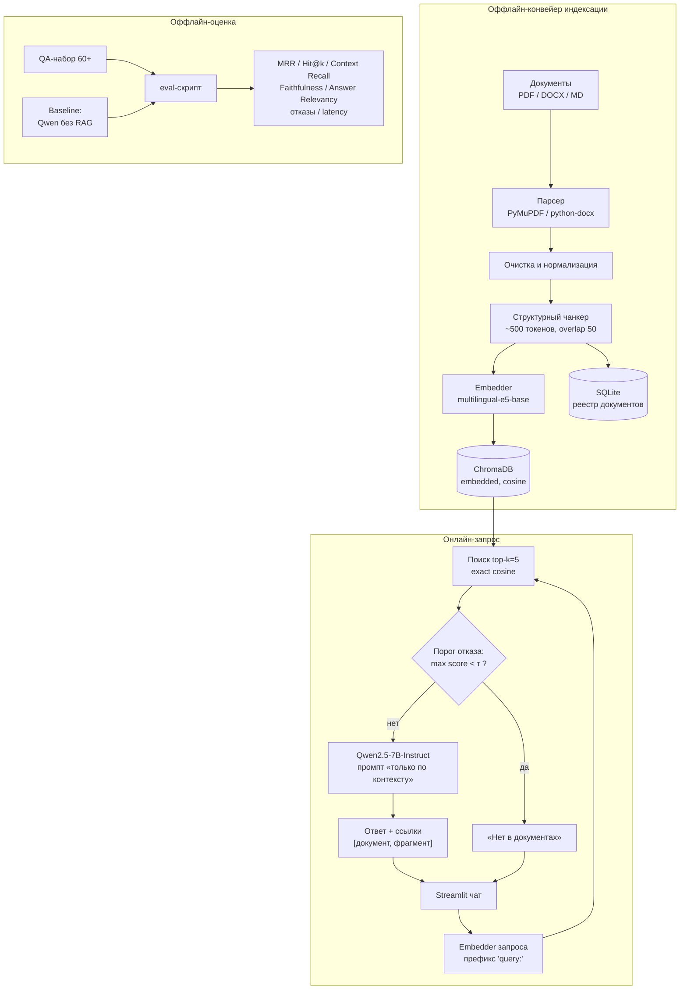

# Архитектура решения

## Общая схема



## Три потока данных

### 1. Индексация (оффлайн, по событию загрузки/переиндексации)

```
файл → парсинг в текст → очистка → структурный чанкинг
     → эмбеддинг чанков (passage:) → запись в ChromaDB + реестр в SQLite
```

- Запускается из админки (загрузка файла) или CLI (`python -m src.ingest`).
- **Идемпотентность**: ключ чанка = `sha256(документа) + индекс чанка`; повторная загрузка
  того же файла (по хэшу) отклоняется, переиндексация удаляет старые записи коллекции
  по `doc_id` и записывает новые.
- Состояние документа в реестре: `pending → indexing → ready | error` (+ текст ошибки).

### 2. Запрос (онлайн, синхронный)

```
вопрос → эмбеддинг (query:) → exact-поиск top-5 в Chroma
       → если max score < τ → отказ «Нет в документах»
       → иначе → промпт с чанками → Qwen → ответ + ссылки → Streamlit
```

- Поиск **плоский (exact)**: при 500–5000 чанков × 768-dim скан по матрице занимает
  единицы миллисекунд — индексы (HNSW/IVFFlat) не нужны. Это зафиксировано явно, чтобы
  не тратить время на настройку приближённого поиска.
- Порог `τ` и `top_k` — настраиваемы в админке и хранятся в конфиге/сессии (см. [pipeline.md](pipeline.md)).

### 3. Оценка (оффлайн, воспроизводимый скрипт)

```
QA-набор → retrieval-метрики (MRR, Hit@k, Context Recall)
         → generation-метрики (LLM-as-judge: Faithfulness, Answer Relevancy)
         → метрики отказов (correct / false refusal) → latency p50/p95
         → таблица: RAG vs baseline (Qwen без RAG)
```

Подробности — в [evaluation.md](evaluation.md).

## Компоненты

| Компонент | Файл (целевая структура) | Ответственность |
|---|---|---|
| Парсер | `src/ingest/parser.py` | PDF/DOCX/MD → чистый текст + метаданные (заголовки, номера страниц) |
| Чанкер | `src/ingest/chunker.py` | структурное разбиение → блоки ~500 токенов с перекрытием 50 |
| Индексатор | `src/ingest/indexer.py` | эмбеддинг, запись в Chroma/SQLite, идемпотентная переиндексация |
| Ретривер | `src/retrieve/search.py` | эмбеддинг запроса, top-k, фильтры по документам |
| Порог отказа | `src/retrieve/gate.py` | решение «ответить / отказать» по max score (+ разрыв top1–top2) |
| Генератор | `src/generate/answer.py` | сборка промпта, вызов LLM, разбор ответа, извлечение ссылок |
| LLM-клиент | `src/llm/client.py` | Ollama / OpenAI-совместимый API, единый интерфейс, таймауты, ретраи |
| Метрики | `src/eval/metrics.py` | MRR, Hit@k, Faithfulness, refusal-метрики, latency |
| UI чата | `app.py` + `src/ui/chat.py` | потоковый чат, история, источники |
| UI админки | `src/ui/admin.py` | загрузка, реестр, топ-к/порог, переиндексация, вкладка метрик |

## Модель данных

**ChromaDB** — коллекция `chunks`:

| Поле | Тип | Назначение |
|---|---|---|
| `id` | str | `"{doc_sha256}:{chunk_index}"` |
| `document` | str | текст чанка (хранится в Chroma) |
| `embedding` | float[768] | нормированный вектор, пространство `cosine` |
| `metadata.doc_id` | str | FK на документ |
| `metadata.doc_name` | str | отображаемое имя (для ссылок) |
| `metadata.chunk_index` | int | порядок чанка |
| `metadata.heading` | str | ближайший заголовок / пункт (для навигации) |
| `metadata.page` | int\|null | номер страницы (PDF, если доступен) |
| `metadata.source_type` | str | pdf / docx / md |

**SQLite** (`data/registry.db`) — таблица `documents`:

| Поле | Тип | Назначение |
|---|---|---|
| `id` | str (uuid) | идентификатор |
| `name` | str | имя файла |
| `sha256` | str | дедупликация, ключ идемпотентности |
| `status` | str | pending / indexing / ready / error |
| `chunks_count` | int | число чанков |
| `error` | str\|null | текст ошибки парсинга |
| `uploaded_at` | datetime | время загрузки |

Тексты ответов и история чатов в БД **не сохраняются** (только `st.session_state`) —
принцип минимизации данных для внутренних документов.

## Конфигурация

Единый источник — `config.yaml` + переменные окружения `.env`:

```yaml
# config.yaml
models:
  embedding: intfloat/multilingual-e5-base      # или multilingual-MiniLM-L12-v2 (light)
  llm: qwen2.5:7b                                # Ollama tag
  llm_endpoint: ${OLLAMA_BASE_URL}               # http://localhost:11434
retrieval:
  top_k: 5                                       # 3..10, правится в админке
  threshold: 0.55                                # стартовый кандидат, финал — калибровка
  candidate_pool: 20                             # запас под будущий reranker
chunking:
  size_tokens: 500
  overlap_tokens: 50
  min_tokens: 50
generation:
  temperature: 0.2
  max_tokens: 700
```

```bash
# .env
OLLAMA_BASE_URL=http://localhost:11434
# OPENAI_API_KEY=...          # опциональный API-fallback для LLM/judge
# RAG_EMBED_DEVICE=cpu        # cpu | cuda
```

`top_k` и `threshold`, изменённые в админке, перекрывают значения `config.yaml` в текущей
сессии; кнопка «Сохранить в конфиг» фиксирует их постоянно.

## Почему PostgreSQL + pgvector заменён на ChromaDB

1. **Масштаб не требует сервера БД**: 500–5000 чанков × 768-dim ≈ несколько МБ.
   pgvector даёт отдельный сервер, миграции, дискер-оркестрацию — ради линейного скана,
   который и так мгновенный.
2. **ChromaDB встраивается в приложение**: zero-серверов, персистентность на диске,
   готовая метрика `cosine`, фильтры по метаданным (поиск по конкретным документам),
   API совпадает с привычным «collection + add + query».
3. **Упрощает запуск и демо**: `streamlit run app.py` без поднятия Postgres — меньше
   точек отказа на защите.
4. **Реестр документов** (статусы, хэши) ложится на SQLite из стандартной библиотеки —
   без ORM и миграций.

Если позже понадобится серверный вариант (мультипользовательский доступ, тысячи
документов) — миграция на pgvector тривиальна: те же поля `chunks(doc_id, text, embedding)`,
код ретривера меняется лишь в слое доступа к хранилищу.
